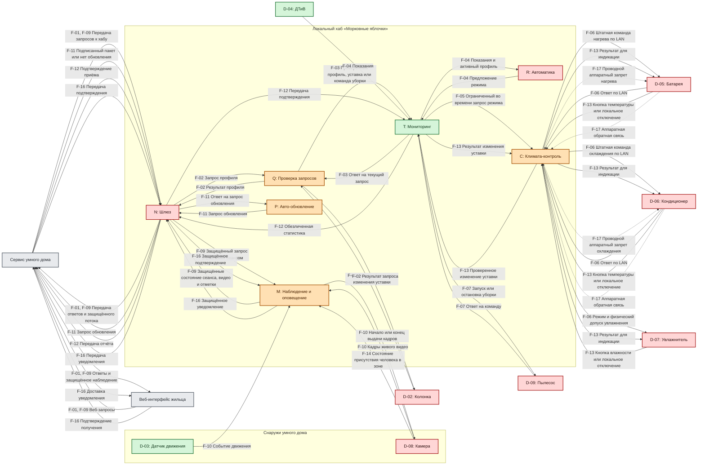

# Итоговая политика архитектуры — DFD

Стрелки показывают разрешённые сообщения или физические разрешения. Штатный обмен домашних устройств идёт по LAN, в том числе с наружным датчиком движения и камерами. Пунктир F-17 — отдельные от LAN проводные линии аварийного отключения батареи и кондиционера с аппаратной обратной связью. N, R, T, Q, M, C и P — части одного хаба. Веб-интерфейс жильца обращается к хабу из внешней сети только через сервис и N; хаб и сервис проверяют подлинность друг друга. Потоки описаны в [спецификации](MESSAGE_CONTRACTS.md), цвета — в [таблице доменов](DOMAIN_ASSIGNMENT.md).

