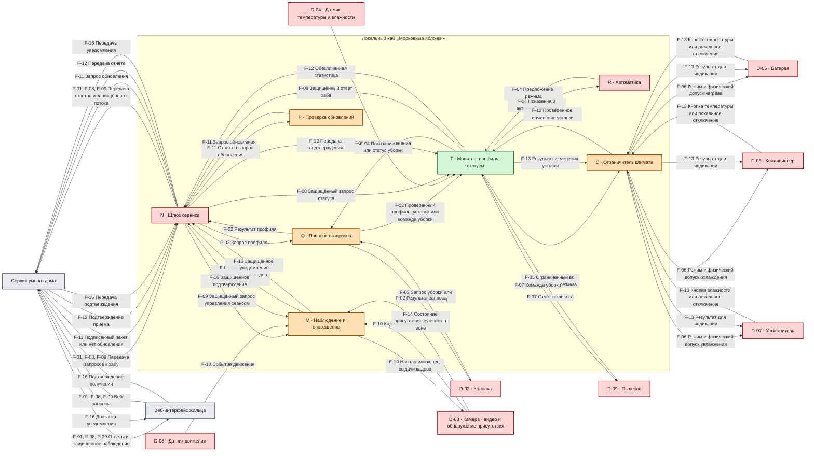

# Итоговая политика архитектуры — DFD

Стрелки показывают разрешённые сообщения или физические разрешения. Все домашние устройства находятся в одной LAN; N, R, T, Q, M, C и P — части одного хаба. Веб-интерфейс жильца находится во внешней сети и обращается к хабу только через сервис и N. Весь обмен хаба с сервисом проходит через канал с взаимной проверкой подлинности. Идентификаторы F-01…F-16 раскрыты в [спецификации](MESSAGE_CONTRACTS.md). Цвета и принадлежность устройств описаны в [таблице доменов](DOMAIN_ASSIGNMENT.md).

