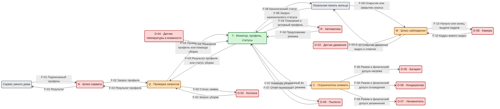

# Итоговая политика архитектуры — DFD

Стрелки показывают разрешённые сообщения или физические разрешения. Идентификаторы F-01…F-10 раскрыты в [спецификации](MESSAGE_CONTRACTS.md). Цвета и принадлежность физических устройств описаны в [таблице доменов](DOMAIN_ASSIGNMENT.md).

