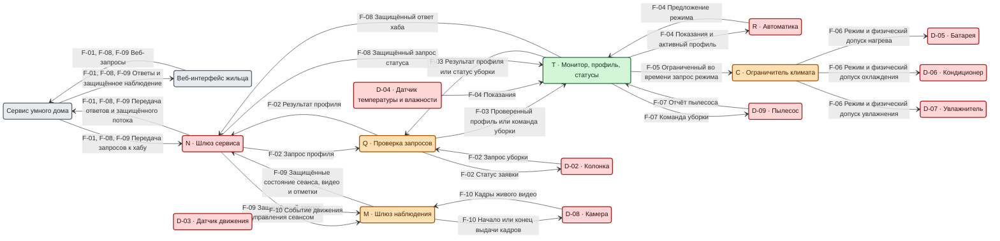

# Итоговая политика архитектуры — DFD

Стрелки показывают разрешённые сообщения или физические разрешения. Все домашние устройства находятся в одной LAN; N, R, T, Q, M и C — части одного хаба. Веб-интерфейс жильца находится во внешней сети и обращается к хабу только через сервис и N. Идентификаторы F-01…F-10 раскрыты в [спецификации](MESSAGE_CONTRACTS.md). Цвета и принадлежность устройств описаны в [таблице доменов](DOMAIN_ASSIGNMENT.md).

