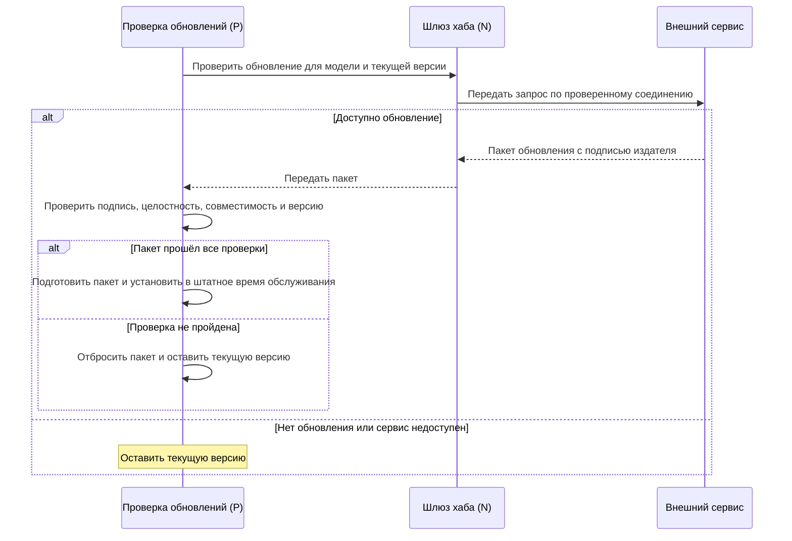
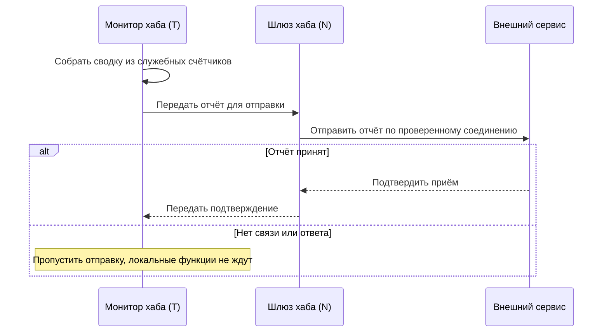

# Служебные сценарии хаба

Оба сценария запускает сам хаб. Сервис и хаб проверяют ключи друг друга при установлении защищённого соединения ([A-02](../security_objectives/SECURITY_ASSUMPTIONS.md#L6), [контракты сообщений](MESSAGE_CONTRACTS.md)). Хаб отбрасывает сообщения, которые не прошли проверку. Если связи с сервисом нет, локальные сценарии продолжают работу и не ждут служебного обмена.

## Автообновление хаба (F-11)

Запрос по расписанию хаба только проверяет наличие обновления. Пакет для другой модели, неподписанный пакет или возврат к более старой версии не допускаются. Установка начинается только после получения и проверки всего пакета и не зависит от дальнейшей доступности сервиса. При штатном перезапуске действует проверяемая загрузка (A-07).

## Отправка обезличенной статистики (F-12)

В отчёте только технические сводки за период, например число перезапусков и внутренних ошибок без журнала отдельных событий. В нём нет идентификаторов жильца, видео, отметок о движении, содержимого команд или истории использования устройств. Сервис может связать отчёт с хабом по ключу соединения: обезличено содержимое отчёта, а не его отправитель.
