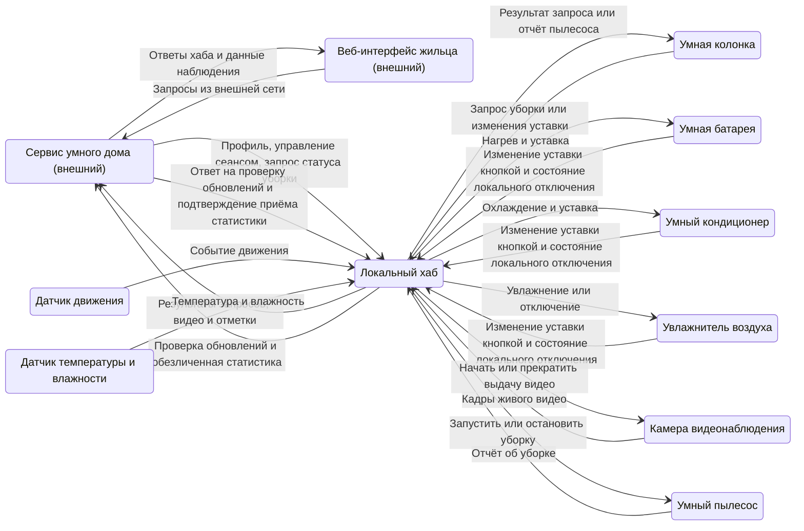

# Исходная архитектура и функциональные связи

Хаб и остальные восемь устройств находятся в одной LAN. Штатные сетевые связи домашних устройств идут только через хаб; веб-интерфейс обменивается с хабом через внешний сервис.
