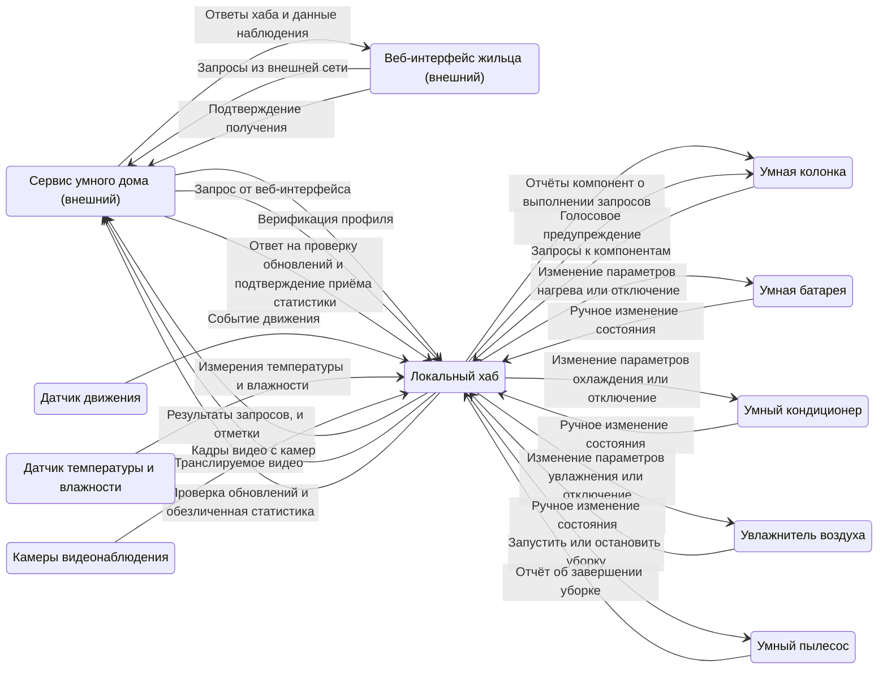

# Исходная архитектура и функциональные связи

Хаб и устройства остальных восьми типов находятся в одной LAN дома или квартиры. Штатные связи идут через хаб, а веб-интерфейс обменивается с хабом через внешний сервис.
