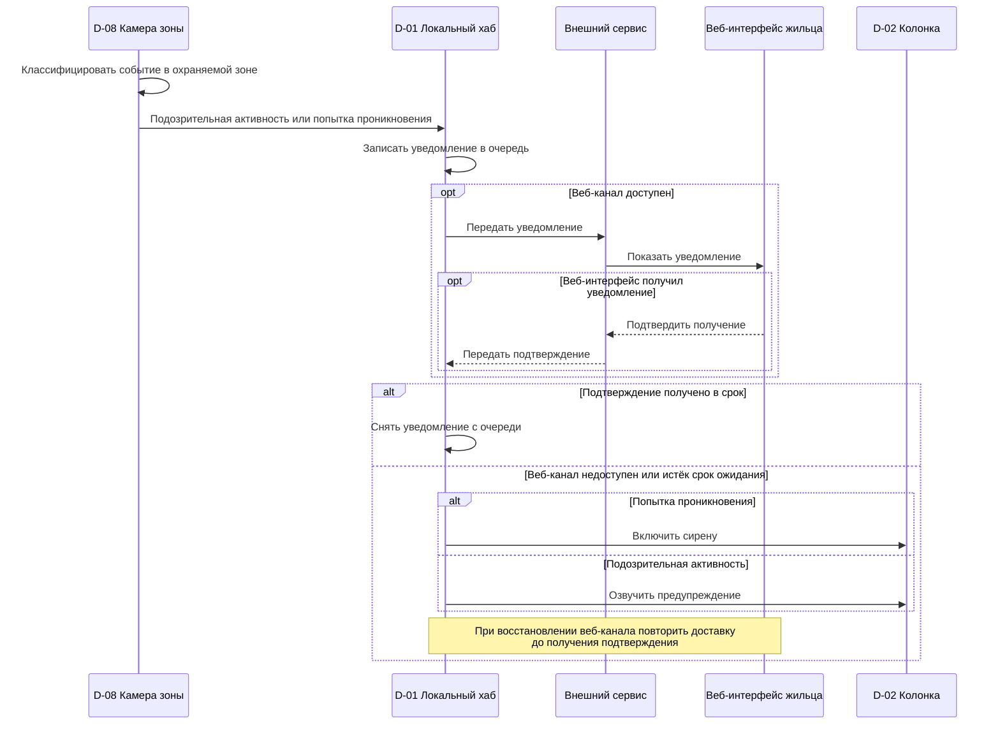

# S-05. Оповещение охраны на исходной HLA

Размещение камер зависит от планировки дома или квартиры. Обмен камеры и колонки с хабом идёт по LAN. Сеанс живого просмотра не нужен: видео обрабатывается камерой локально, хаб получает категорию события. Привязка уведомления к получателю, изоляция звука охраны и правила очереди описаны в [итоговой политике](../architecture_policy/MESSAGE_CONTRACTS.md).
