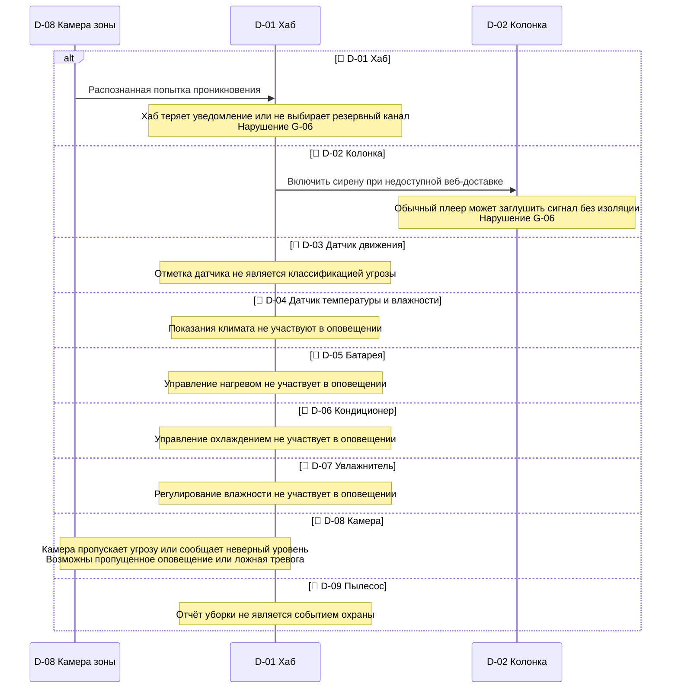

# S-05. Негативные сценарии оповещения охраны

В итоговой архитектуре распознавание отделено от обычного видеопотока, а тракт звука охраны — от плеера. Потеря распознавания или охвата зоны нарушает A-08. Если сервис не доставил уведомление либо не передал подлинное подтверждение от веб-интерфейса, M сохраняет запись и подаёт локальный сигнал по [правилам F-14…F-16](../architecture_policy/MESSAGE_CONTRACTS.md).
