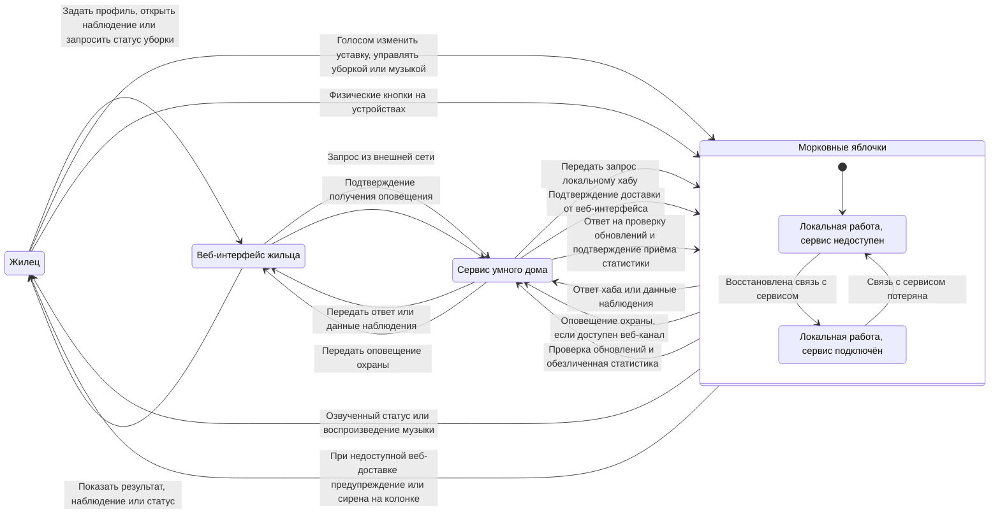

# Контекст системы

Колонка и остальные устройства взаимодействуют с хабом в одной LAN. У веб-интерфейса нет прямого маршрута к хабу: при потере интернета или связи с сервисом веб-функции недоступны.

Система обслуживает отдельный дом или квартиру. Если веб-уведомление охраны не доставлено, хаб хранит его и отправляет при восстановлении связи.
