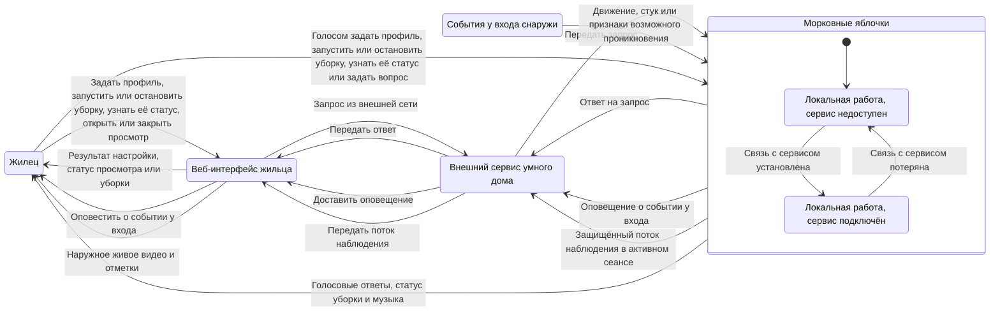

# Контекст системы

Диаграмма показывает внешние взаимодействия «Морковных яблочек» и два состояния связи с сервисом. Она опирается на [концепцию безопасности продукта](PRODUCT_SECURITY_CONCEPT.md).

- **Наружное наблюдение.** Камера охватывает вход и прилегающую зону снаружи дома. Внутренние помещения исключены из зоны наблюдения. Система оповещает жильца о стуке или признаках возможной попытки проникновения, чтобы он мог отреагировать, в том числе когда находится вне дома или спит. Оповещение не открывает сеанс просмотра. Просмотр доступен только в авторизованном веб-интерфейсе, где жилец сам открывает сеанс. Сервис переносит защищённый поток без доступа к его содержимому. Видеоархив не предусмотрен.
- **Конфиденциальность колонки.** Голос, тексты запросов и ответов, история общения и сведения о прослушивании остаются на колонке. Хаб получает по домашней LAN только распознанную команду или запрос и необходимые параметры.
- **Потеря связи.** Веб-интерфейс работает через внешний сервис. Прямого веб-доступа к хабу из домашней LAN нет. При потере связи недоступны веб-функции, включая доставку оповещений через сервис. При исправных локальных участниках доступны голосовая настройка микроклимата, запуск и остановка уборки и запрос её статуса. Продолжают работать локальные функции колонки и климатическая автоматизация с последним допустимым профилем и актуальными показаниями.
