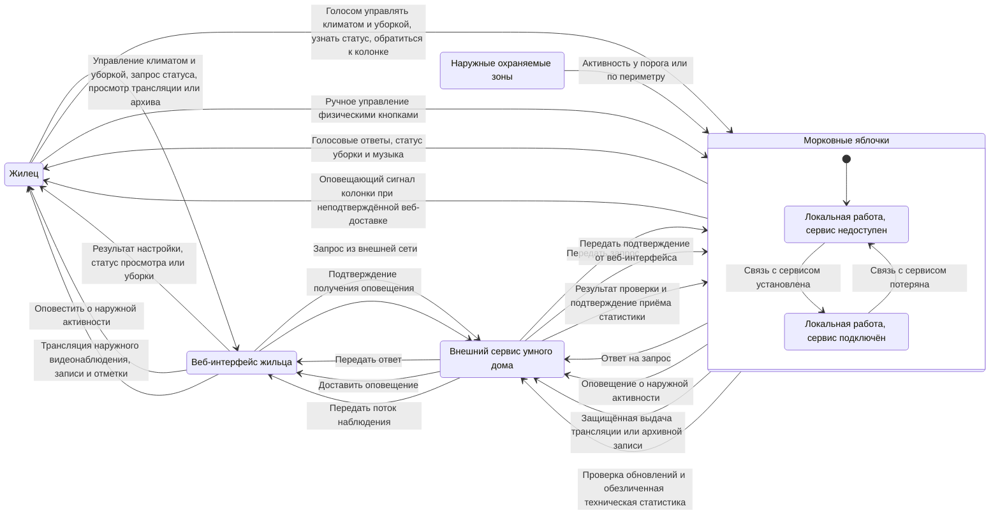

# Контекст системы

Диаграмма показывает внешние взаимодействия «Морковных яблочек» и два состояния связи с сервисом. Она опирается на [концепцию безопасности продукта](PRODUCT_SECURITY_CONCEPT.md).

- **Наружное наблюдение.** В квартире наблюдение охватывает зону перед входной дверью. В частном доме дополнительные камеры могут покрывать окна, точки подхода и периметр. Внутренние помещения исключены. Оповещение сообщает зону и время активности независимо от сеанса просмотра. Жилец открывает трансляцию в авторизованном веб-интерфейсе, оценивает ситуацию и выбирает реакцию. Сервис переносит защищённый поток без доступа к его содержимому. Архив наружного видеонаблюдения хранится на хабе. Через авторизованный веб-интерфейс жилец может открыть трансляцию или запросить запись из архива.
- **Команды жильца.** Через веб-интерфейс и голосом через колонку можно настроить микроклимат, запустить или остановить уборку и запросить её статус. Вопросы и команды управления музыкой жилец задаёт колонке локально голосом. Физические кнопки позволяют управлять устройствами на месте.
- **Конфиденциальность колонки.** Голос, тексты запросов и ответов, история общения и сведения о прослушивании остаются на колонке. Хаб получает по домашней LAN только распознанную команду или запрос и необходимые параметры.
- **Потеря связи.** Веб-интерфейс работает через внешний сервис. Прямого веб-доступа к хабу из домашней LAN нет. При потере связи недоступны веб-функции, включая доставку оповещений через сервис. Если веб-доставка не подтверждена в срок, звучит оповещающий сигнал колонки об активности в наружной зоне, а хаб сохраняет оповещение и повторяет доставку после восстановления связи. При исправных локальных участниках доступны голосовая настройка микроклимата, запуск и остановка уборки и запрос её статуса. Продолжают работать локальные функции колонки и климатическая автоматизация с последним допустимым профилем и актуальными показаниями.
