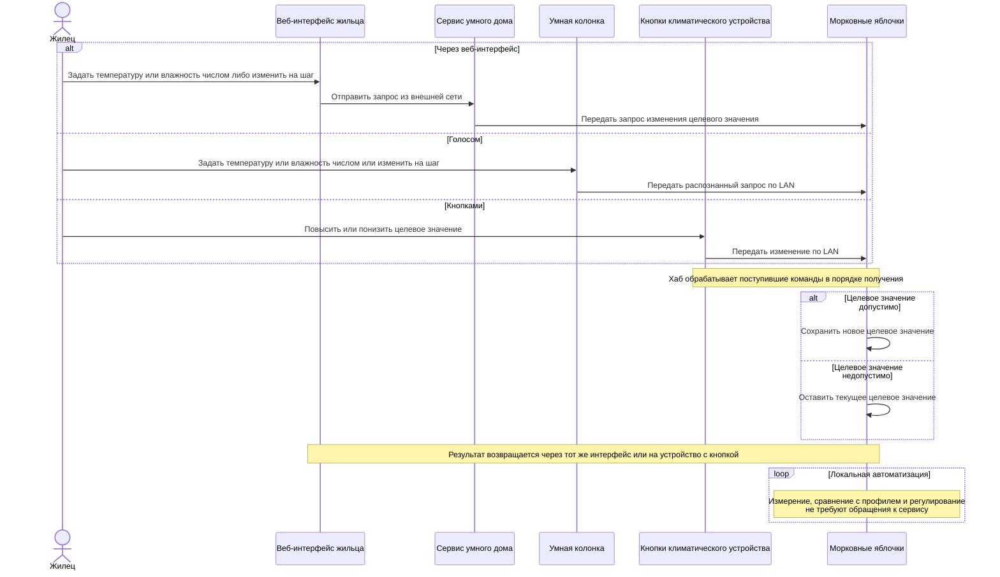

# S-01. Настройка и поддержание микроклимата

«Поставь 22 °C» и «поддерживай влажность 45%» задают целевые значения. «Теплее» и «холоднее» повышают и понижают целевую температуру на один шаг. «Слишком сухо» повышает целевую влажность, «слишком влажно» понижает её. Относительная команда меняет текущее целевое значение, а не показание датчика. Кнопки «+» и «−» работают так же для соответствующей величины. Если новое целевое значение выходит за безопасный диапазон, хаб сохраняет прежнее значение. Голосовой ответ и индикация на устройстве подтверждают изменение цели, а не мгновенное изменение температуры или влажности.

При отсутствии актуальных показаний регулирование приостанавливается. Если климатический режим отключён физической кнопкой, изменение целевого значения через любой интерфейс не возобновляет работу. Снова разрешить режим можно кнопкой на самом устройстве.
