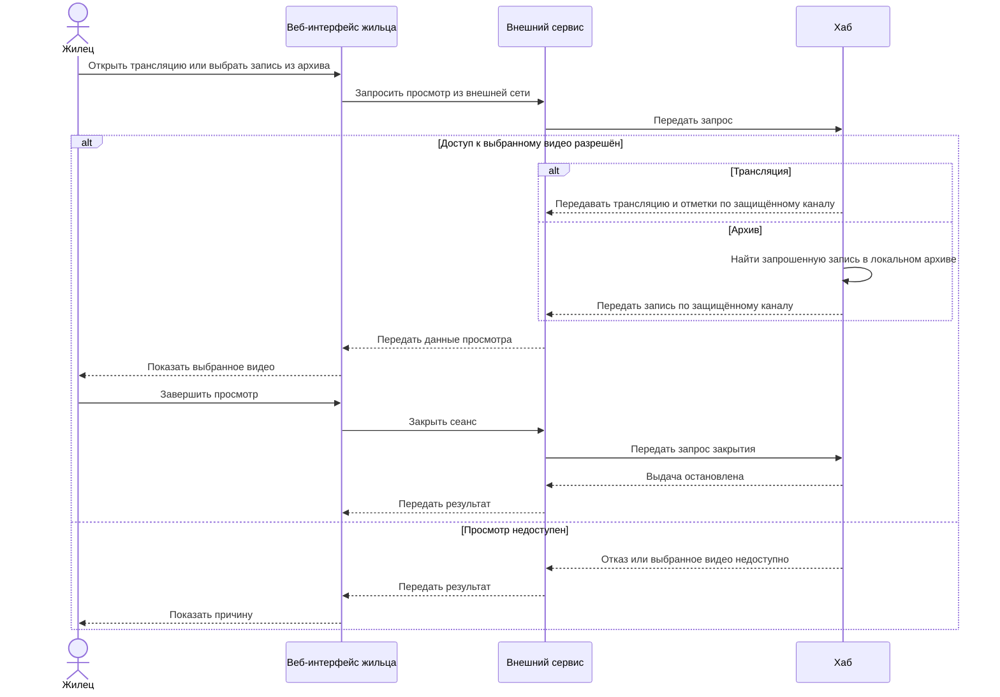

# S-02. Наружное видеонаблюдение

Трансляция, записи и отметки доступны в авторизованном веб-интерфейсе. Архив записей хранится на хабе.

Камеры охватывают зону перед входом в квартиру. В частном доме они могут дополнительно охватывать окна, точки подхода и периметр. Внутренние помещения исключены из зоны наблюдения. Если съёмка выключена кнопкой, открытие просмотра её не возобновляет. Зона без покрытия отмечается как недоступная для текущего наблюдения. Включить съёмку снова можно кнопкой на самой камере.

При потере связи с внешним сервисом веб-просмотр прекращается. Архивные записи остаются на хабе.
