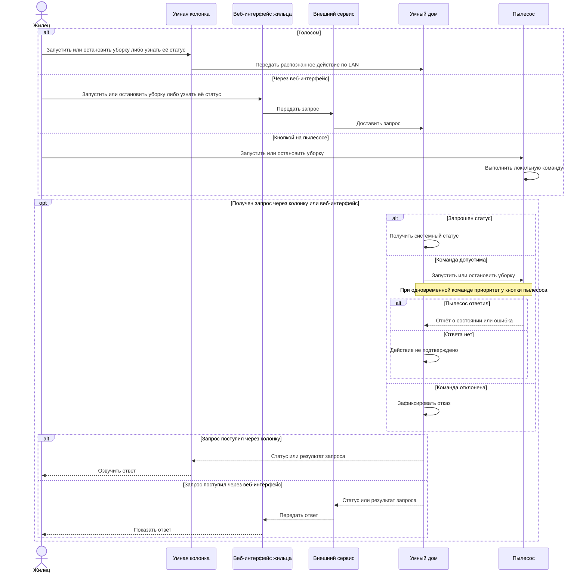

# S-03. Управление уборкой и проверка статуса

Голосовое управление и запрос статуса работают по LAN при исправных локальных участниках. Кнопка пылесоса работает без связи с хабом. Системный статус различает отказ, принятие заявки, отчёт устройства и отсутствие подтверждения. Отчёт устройства не подтверждает результат уборки независимо.
