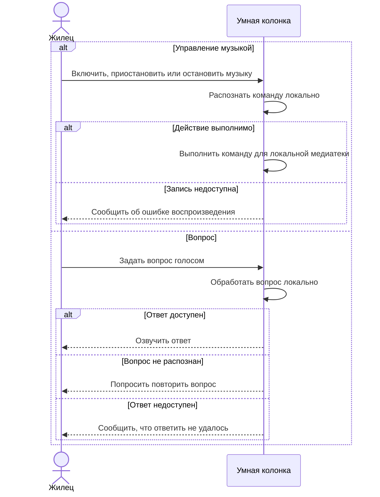

# S-04. Локальное взаимодействие с умной колонкой

Для голосового обращения микрофон должен быть включён. Колонка обрабатывает вопросы и команды управления музыкой на самом устройстве. Голос, содержание общения и сведения о прослушивании остаются на колонке. Для этого сценария достаточно исправной колонки. Воспроизведение также можно остановить кнопкой на устройстве.
