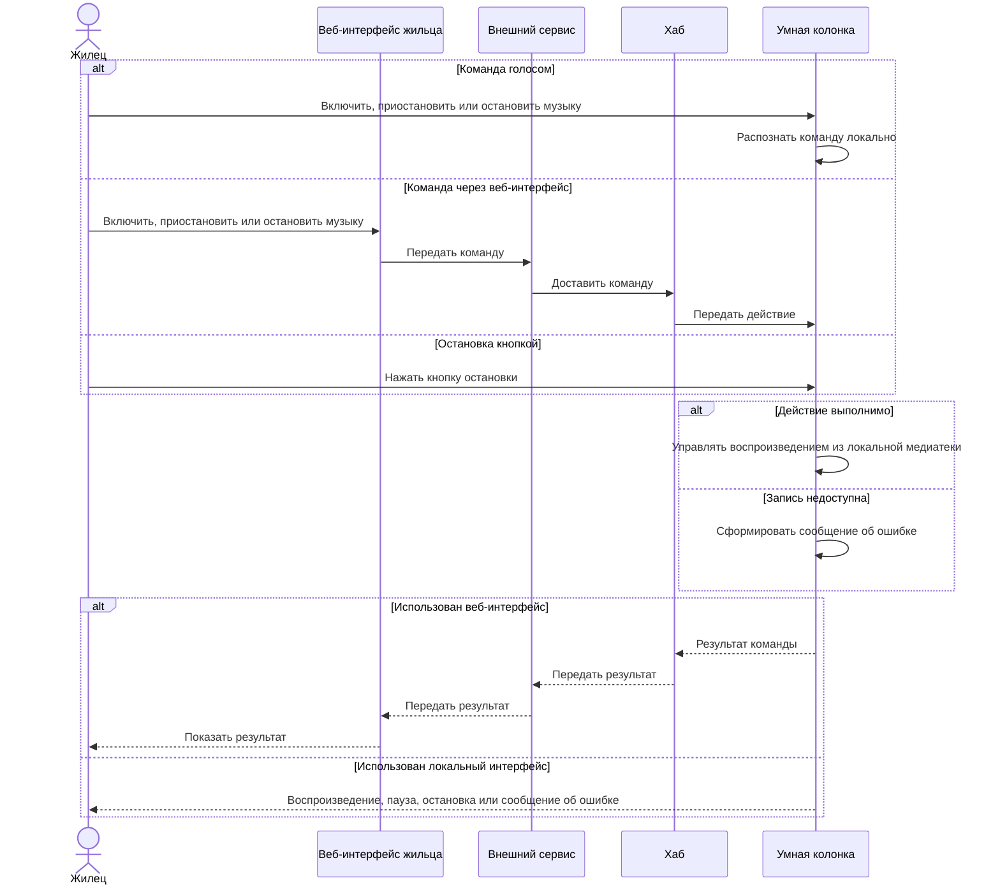

# S-04. Воспроизведение музыки

Голосовые команды управления музыкой выполняются на колонке. Голос, история запросов и сведения о прослушивании остаются на ней. Веб-интерфейс получает результат своей команды. При потере связи с сервисом доступны голосовое управление и физическая кнопка.
