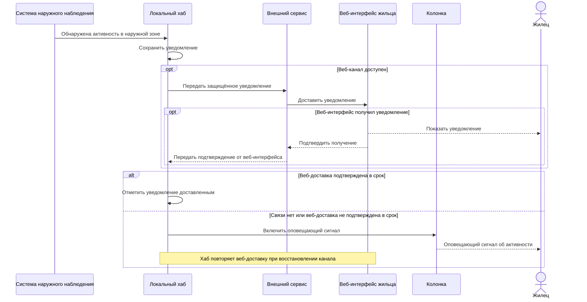

# S-05. Оповещение об активности снаружи

Система оповещает об обнаруженной активности, например движении или стуке у двери. В квартире наблюдение охватывает зону перед входной дверью, а в частном доме дополнительные камеры могут охватывать окна, точки подхода и периметр. Оповещение содержит зону и время события и доставляется независимо от сеанса просмотра.

При неподтверждённой веб-доставке колонка подаёт оповещающий сигнал. Хаб сохраняет уведомление и повторяет доставку после восстановления связи. Подтверждение означает получение уведомления веб-интерфейсом. Оповещение приходит без кадров. Жилец может отдельно открыть [трансляцию](S02_MONITORING.md), оценить активность и выбрать реакцию.
