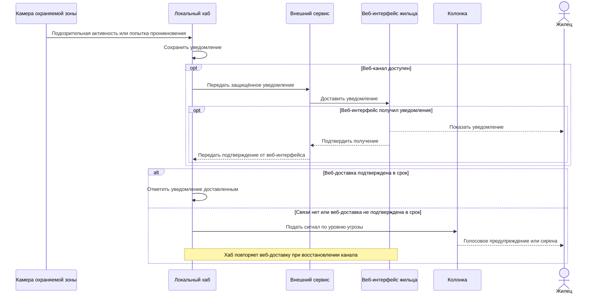

# S-05. Оповещение о попытке проникновения

Камеры покрывают входные двери, окна и остальные точки подхода, где в отдельном доме или квартире может появиться посетитель или нарушитель. Обычное появление посетителя само по себе не вызывает тревогу. Камера локально различает подозрительную активность и попытку проникновения; для этого не нужен открытый сеанс просмотра.

Сирена звучит на той же колонке. После восстановления веб-канала жилец получает сохранённое уведомление, даже если не был дома и не слышал звук. Подтверждение веб-доставки означает получение уведомления интерфейсом, а не прочтение жильцом. Уведомление не содержит кадров и не открывает просмотр; живое видео запрашивается отдельно в [S-02](S02_MONITORING.md).
