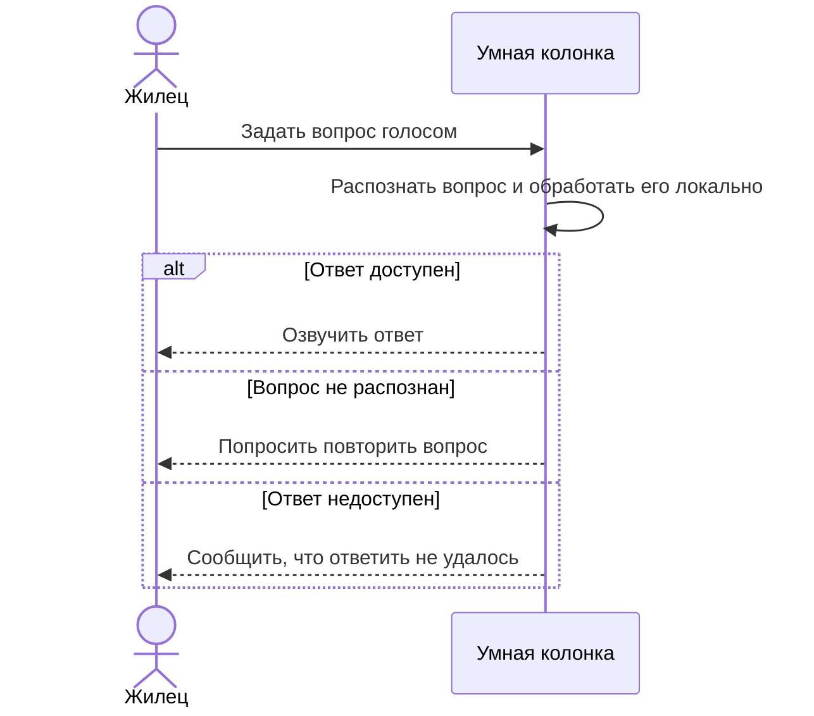

# S-06. Вопрос и ответ через умную колонку

Для голосового вопроса микрофон должен быть включён. Колонка обрабатывает вопрос и формирует ответ локально. Голос, текст вопроса и ответ остаются на колонке. Сценарий работает без интернета и связи с хабом при исправной колонке.
